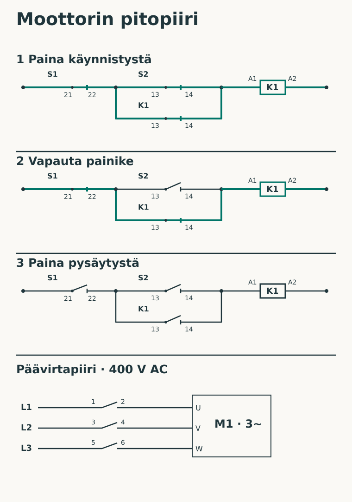

## Mistä nimi tulee?

Staattori on moottorin paikallaan pysyvä osa ja roottori pyörivä osa. Kolmivaihevirta synnyttää staattoriin pyörivän magneettikentän. Pyörivä kenttä synnyttää jännitteen roottorin sauvoihin. Tätä kutsutaan induktioksi. Sauvojen päät on yhdistetty renkailla suljetuksi virtapiiriksi, joten niissä pääsee kulkemaan virta. Tästä rakenteesta tulee nimi *oikosulkumoottori*. Roottorivirran ja magneettikentän yhteisvaikutus tuottaa akselia pyörittävän vääntömomentin.

**Miksi roottori jää jälkeen?** Kolme vaihevirtaa saavuttavat huippunsa vuorotellen. Kun ne kulkevat staattorin eri kohtiin sijoitetuissa johdinkäämeissä, yhteinen magneettikenttä kiertää roottorin ympäri. Jos roottori saavuttaisi kentän nopeuden, kenttä pysyisi roottorin suhteen paikallaan. Silloin roottorin sauvoihin ei indusoituisi jännitettä eikä moottori tuottaisi kuorman vaatimaa momenttia. Kun esimerkiksi puhaltimen akselin kuormitus kasvaa, roottori hidastuu hieman. Kentän ja roottorin nopeuseroa kutsutaan jättämäksi. Normaalilla käyntialueella jättämän kasvu lisää roottorivirtaa ja vääntömomenttia, kunnes momentti taas vastaa kuormaa.

## Miksi toinen moottori käy tähdessä ja toinen kolmiossa?

**Δ (delta) tarkoittaa kolmiokytkentää ja Y tähtikytkentää.** Symbolit kuvaavat kolmen käämin yhteyttä. Tähdessä käämien päät kohtaavat yhdessä pisteessä. Kolmiossa kunkin käämin loppu yhdistyy seuraavan alkuun, jolloin muodostuu suljettu kolmio.

Esimerkin verkossa kahden vaiheen välillä on 400 V. Moottorin arvokilpi on valmistajan tietokilpi, joka ilmoittaa muun muassa nimellisjännitteen, kytkennän ja nimellisvirran. Taulukon ensimmäinen sarake näyttää kahden eri moottorin kilpimerkinnät. Valitse kummastakin se kytkentä, jonka kohdalla lukee 400 V. Kytkentäliuskat yhdistävät staattorin kolmen käämin päät joko tähdeksi tai kolmioksi.

| Arvokilven merkinnät | Käyntikytkentä 400 V:n verkossa | Jännite yhden käämin yli |
| -------------------- | ------------------------------- | ------------------------ |
| 230 V Δ / 400 V Y    | Tähti (Y)                       | 400 V / √3 ≈ 230 V       |
| 400 V Δ / 690 V Y    | Kolmio (Δ)                      | 400 V                    |

**Seuraa yhtä käämiä.** Esimerkiksi U-käämin päät ovat U1 ja U2. Tähdessä käämien loppupäät U2, V2 ja W2 muodostavat yhteisen tähtipisteen. Yksi käämi on siis vaiheen ja tähtipisteen välissä. Kolmiossa jokainen käämi on kahden vaiheen välissä, joten sen yli vaikuttaa koko pääjännite.

**Esimerkki liitinalustan järjestyksestä.** Ylärivillä lukee W2, U2, V2 ja alarivillä U1, V1, W1. Seuraa ensin U1–U2-käämiä. Tähdessä U2 kuuluu yhteiseen tähtipisteeseen. Kolmiossa U1 on samassa liitospisteessä kuin W2 ja U2 samassa kuin V1. Näin U-käämin päät päätyvät eri vaiheisiin. Liittimien tunnukset kertovat yhteyden myös silloin, kun liitinalustan asento vaihtuu.

**Milloin tähti vaihtuu kolmioksi?** Ensimmäisen taulukkorivin moottori käy 400 V:n verkossa jatkuvasti tähdessä. Kolmiossa sen 230 V:n käämille tulisi 400 V. Toisen rivin moottorin nimellinen käyntikytkentä on tässä verkossa kolmio. Jos sen käynnistystavaksi valitaan tähti–kolmio, kontaktorit yhdistävät käämit ensin tähteen ja kiihdytyksen jälkeen kolmioon. Tähtivaiheessa verkosta otettava käynnistysvirta ja käynnistysmomentti ovat likimain kolmannes suoran kolmiokäynnistyksen arvoista. Kuorman täytyy siksi lähteä liikkeelle pienemmällä momentilla.

## Arvokilven lukeminen käytännössä

Esimerkkimoottorin arvokilven merkinnöissä **230/400 V Δ/Y** ja **2,87/1,65 A** vinoviivan samalla puolella olevat tiedot kuuluvat yhteen. Virta tarkoittaa syöttöjohtimen virtaa nimelliskuormalla. Kilven arvot koskevat 50 Hz:n taajuutta.

| Verkon pääjännite | Kytkentä   | Nimellisvirta |
| ----------------- | ---------- | ------------- |
| 230 V             | Δ (kolmio) | 2,87 A        |
| 400 V             | Y (tähti)  | 1,65 A        |

**Miksi samalle käämille ilmoitetaan kaksi eri verkkojännitettä ja virtaa?** Molemmissa arvokilven käyttöpisteissä yhden käämin jännite on noin 230 V ja sen läpi kulkee nimelliskuormalla noin 1,65 A. Tähdessä syöttöjohtimen virta kulkee suoraan yhteen käämiin. Kolmiossa syöttöjohdin liittyy kahden käämin yhteiseen kulmaan. Symmetrisessä kolmivaihekuormassa vaihe-erojen vuoksi johtimen virta on √3 kertaa käämivirta. Siksi kilvessä on kolmiolle noin 2,87 A ja tähdelle 1,65 A.

**Mihin teho menee?** Kilven 0,75 kW on akselilta saatava mekaaninen teho. Hyötysuhde η = 81 % kertoo, kuinka suuri osa sähköisestä ottotehosta päätyy akselille. Nimelliskuormalla ottoteho on siis noin 0,75 kW / 0,81 = 0,93 kW. Myös tehokerroin cos φ on tällä moottorilla 0,81. Se kertoo pätötehon osuuden näennäistehosta. IE2 on hyötysuhdeluokka.

**Miksi kilvessä lukee 1 430 r/min eli kierrosta minuutissa?** Nelinapaisen moottorin magneettikenttä pyörii 50 Hz:n taajuudella 1 500 r/min. Nimelliskuormalla roottori jää kentästä 70 r/min. Tätä nopeuseroa kutsutaan jättämäksi, ja suhteessa kentän nopeuteen se on noin 4,7 %.

**Tarkista laskemalla.** Kentän nopeus saadaan kaavasta nₛ = 120f / N, jossa f on taajuus hertseinä ja N napojen lukumäärä. Tässä 120 × 50 / 4 = 1 500 r/min. Akselin nimellismomentti saadaan akselitehosta ja akselin nopeudesta: M ≈ 9 550 × 0,75 kW / (1 430 r/min) ≈ 5,0 N·m. Tämä on akselin vääntömomentti nimelliskuormalla.

**Muut kilpitiedot.** S1 tarkoittaa jatkuvaa käyttöä, IP55 on kotelointiluokka ja F (155 °C) käämityksen eristyksen lämpöluokka. IM B3 tarkoittaa jalka-asennusta. Runkokoko on 80 ja massa 17 kg.

## Moottorilähdön suojaus

Tässä esimerkissä 0,75 kW:n moottori käy 400 V:n verkossa tähdessä. Sen nimellisvirta on 1,75 A. Edellisen arvokilven moottorilla on sama akseliteho mutta eri nimellisvirta (1,65 A).

Yhden vaiheen virtareitti on seuraava: F01 (gG-sulake) → Q01 (kontaktori) → F02 (lämpörele) → Q10 (turvakytkin) → M01 (moottori). Kaikki kolme vaihetta kulkevat saman reitin. Suojajohdin PE jatkuu moottorin runkoon turvakytkimen koskettimien ohi.

| Esimerkin arvo  | Mitä se tarkoittaa?                                                                                                                        |
| --------------- | ------------------------------------------------------------------------------------------------------------------------------------------ |
| 1,75 A          | Moottorin nimellisvirta ja tämän lämpöreleen asetus. Lämpörele suojaa moottoria pitkittyvältä ylikuormitukselta.                           |
| 1,7–2,3 A       | Lämpöreleen säätöalue. Rele sopii esimerkkiin, koska 1,75 A kuuluu tälle välille.                                                          |
| 6 A tai 10 A gG | Kirjan esimerkissä oikosulkusuojan vaihtoehdot. Käynnistysvirta määrää 6 A:n alarajan ja lämpöreleelle sallittu etusulake 10 A:n ylärajan. |

**Voiko gG-sulakkeen valita kertomalla nimellisvirran 2,5:llä?** Pelkkä kerroin ei riitä mitoitukseen. Tässä 2,5 × 1,75 A ≈ 4,38 A. Kirjan 6 A:n alaraja perustuu siihen, että sulake kestää käynnistyksen, ja 10 A:n yläraja lämpöreleelle sallittuun etusulakkeeseen. Valmistajan valintataulukosta tai sulakkeen aika–virtakäyrästä tarkistetaan käynnistysvirran suuruus ja kesto. Lisäksi tarkistetaan moottorilähdön laitteiden ja kaapelin suojaus.

**Mitä tapahtuu, jos puhallin jumittuu?** Pysähtyneen moottorin virta voi pysyä suurena ja käämitys kuumenee. Tässä suojausesimerkissä lämpöreleen kosketin 95–96 on sarjassa kontaktorin kelan kanssa. Kun lämpörele laukeaa, kosketin avautuu. Kontaktorin kela menettää jännitteensä, pääkoskettimet avautuvat ja moottorin syöttö katkeaa. Näin päävirtapiirissä havaittu ylikuormitus pysäyttää moottorin ohjauspiirin kautta. Sulakkeiden tehtävä tässä esimerkissä on katkaista suuri oikosulkuvirta.

Kaavio näyttää käynnistys- ja pysäytyspainikkeet sekä kontaktorin oman pitokoskettimen. Edellä kuvattu lämpöreleen kosketin 95–96 puuttuu tästä yksinkertaistetusta kuvasta. Sen avautuminen katkaisee kelavirran samalla tavoin kuin pysäytyspainikkeen painaminen.

Tämän moottorilähdön esimerkkikaapelissa MMJ 4 × 1,5 S on kolme vaihejohdinta ja suojajohdin PE. Kunkin johtimen poikkipinta-ala on 1,5 mm². Kaapeliin liittyvä ≤ 25 A on tässä esimerkissä kaapelille ilmoitettu yläraja. Moottorilähdön sulakevalintaa rajoittaa tässä lämpöreleen 10 A:n enimmäisarvo.

### Moottorikaapelin mekaaninen suojaus

Tässä esimerkissä syöttökaapeli kulkee moottorin lähellä **JAPP-putkessa**. Alumiiniputki suojaa kaapelia esimerkiksi iskuilta. **JAPJ** on tämän esimerkin alumiiniputkelle tarkoitetun taivutusjousen tunnus.

Oppikirjan esimerkissä JAPP 16- ja JAPP 20 -putket voi taivuttaa myös putken kokoon sopivalla muoviputken taivutusjousella. Putken sisällä oleva jousi tukee seinämää, jotta kaarre säilyttää muotonsa. Putkea taivutetaan hieman tavoitekulman yli ja oikaistaan sitten sen verran, että jousen saa vedettyä ulos. Suurempiin putkiin käytetään valmiita kaaria.

## Kertauskysymykset

1. Miten käämien päät yhdistyvät tähtipisteessä? **Tarkistus:** kolmen eri käämin päät yhdistyvät samaan pisteeseen.
2. Miksi 0,75 kW:n moottorin ottotehoksi saadaan noin 0,93 kW? **Tarkistus:** akseliteho on 81 % ottotehosta. Erotus, noin 0,18 kW, kuluu häviöihin.
3. Miksi suojausesimerkissä mainitaan sekä 1,75 A että 6 A? **Tarkistus:** ensimmäinen on moottorin nimellisvirta ja lämpöreleen asetus. Toinen on yksi tämän esimerkin sulakkeen nimellisvirroista.

## Mittaus- ja testauspöytäkirja

Moottorilähdön mittaus- ja testauspöytäkirja  yhdistää kilpiarvot, suojauksen asetukset, mitatut vaihevirrat ja tarkastustuloksen. Esimerkiksi ensimmäisen moottorin 1,65 A on valmistajan ilmoittama nimellisvirta. Jokaisen vaiheen todellinen mittaustulos merkitään erikseen.

## Lähteet ja ylläpitotiedot

Oppitunti 16.11.2026. Muistio kokoaa oppitunnin esimerkit ja niitä täydentävät selitykset. Laitetunnukset ja esimerkkijännitteet kuuluvat kuhunkin kuvattuun harjoitukseen.

### Täydentävät valmistajalähteet

- [ABB:n moottorikäyttöjen käsikirja](https://library.e.abb.com/public/a5861200ea7c59fec1256dc50039e0ed/1SDC010001D0201.pdf)
- [Eatonin IEC-sovellusopas, moottorisulakkeiden valintataulukko 7](https://www.eaton.com/content/dam/eaton/products/low-voltage-power-distribution-controls-systems/low-voltage-switchgear/eaton-consulting-application-guide-for-low-voltage-switchgear-according-to-iec-standards-en-gb.pdf)
