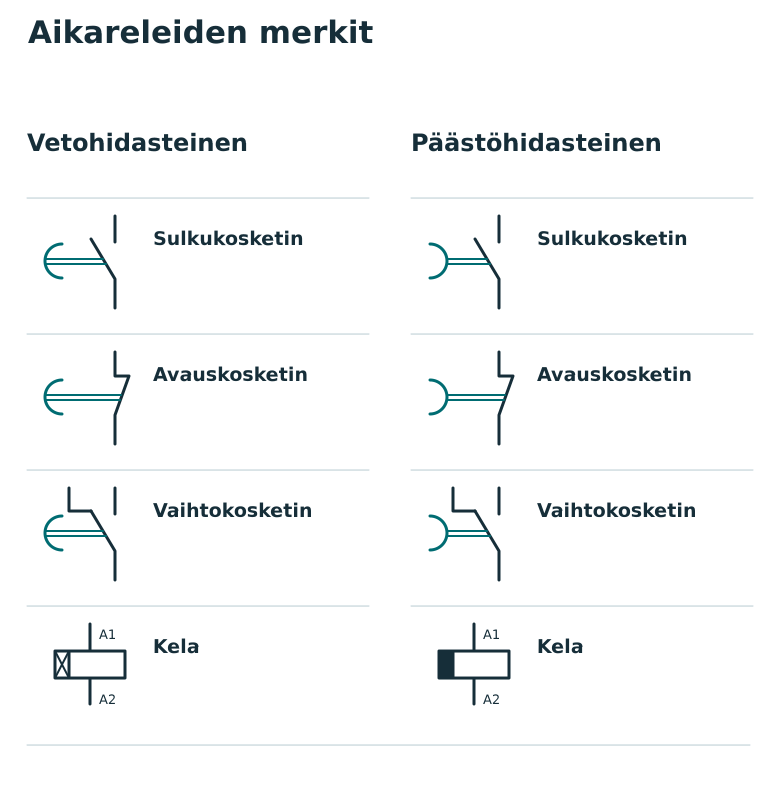

## Rele ja kontaktori

**Sähkömagneettinen rele** on kelalla ohjattu kytkin. Kun kelassa kulkee virta, rautasydän magnetoituu ja vetää liikkuvaa ankkuria puoleensa. Ankkuri siirtää koskettimia. Silloin rele *vetää*. Kun kelavirta katkeaa, tavallisen releen jousi palauttaa koskettimet lepoasentoon. Silloin rele *päästää*.

**Kontaktori** on sähkökäyttöinen kytkin, jonka pääkoskettimet kytkevät esimerkiksi moottorin syötön. Kylmiön suorassa termostaattiohjauksessa voit seurata kahta virtapiiriä.

| Ohjauspiiri                                                                                                           | Päävirtapiiri                                                                             |
| --------------------------------------------------------------------------------------------------------------------- | ----------------------------------------------------------------------------------------- |
| Kun termostaatti pyytää jäähdytystä, sen kosketin sulkeutuu. Virta kulkee kontaktorin kelan läpi ja kontaktori vetää. | Kontaktorin kolme pääkosketinta sulkeutuvat. Moottori saa kolmivaihesyötön ja käynnistyy. |
| Kun termostaatin kosketin avautuu, kelavirta katkeaa ja kontaktori päästää.                                           | Pääkoskettimet avautuvat ja moottorin sähkönsyöttö katkeaa.                               |

**Kontaktorin piirrosmerkki (kuva 4.45).** A1 ja A2 ovat kelan liittimet. Kun kontaktori vetää, kolme pääkosketinta (1–2, 3–4 ja 5–6) sulkeutuvat. Jokainen kytkee yhden vaiheen moottorille. Samalla sulkeutuu levossa avoin apukosketin 13–14, jolla voidaan ohjata esimerkiksi merkkivaloa. Katkoviiva osoittaa, että sama mekanismi liikuttaa kaikkia neljää kosketinta.

**Lisäosat (kuva 4.44).** Apukosketinlohko lisää ohjauspiiriin käytettävissä olevia koskettimia. Moottoria suojaava lämpörele seuraa moottorivirtaa. Pitkittyneen ylikuormituksen seurauksena lämpörele laukeaa ja avaa kontaktorin kelapiiriin kytketyn avauskoskettimensa. Kontaktori päästää ja moottorin syöttö katkeaa.

**Painikeohjaus ja pitopiiri.** K1:n apukosketin on käynnistyspainikkeen rinnalla. Se pitää kelan virrallisena painikkeen vapauttamisen jälkeen. Pysäytyspainike katkaisee molemmat reitit.

Kuvassa S1 on pysäytys, S2 käynnistys ja K1 kontaktori. Vihreä korostus näyttää kelavirran reitin. Keskimmäinen tilanne esittää käynnistyspainikkeen vapauttamista. Pääpiirin koskettimet on piirretty lepoasentoon; suojaukset ja suojajohdin on jätetty tästä toimintaperiaatekuvasta pois.

**Suojakontaktori ja pitopiiri.** Tässä tuntikuvassa S1 on käynnistyspainike (13–14) ja S2 pysäytyspainike (21–22). Painikkeiden tunnukset ovat päinvastoin kuin edellisessä piirroksessa. Moottorin kolmen vaiheen virrat kulkevat K1:n pääkoskettimien ja lämpöreleen F1 kautta. Jos F1 laukeaa, sen kosketin 95–96 avautuu ohjauspiirissä. K1:n kela menettää jännitteen, pitokosketin aukeaa ja pääkoskettimet katkaisevat moottorin syötön. Samalla F1:n kosketin 97–98 sulkeutuu. Sitä voi käyttää hälytykseen. Kuvan H1 on kytketty K1:n kelan rinnalle, joten valo kertoo kelan saamasta jännitteestä.

**Mitä merkkivalo todistaa?** Käyntipyyntöä osoittava valo voi palaa jo ennen kuin kontaktori vetää. Kontaktorin omalla apukoskettimella ohjattu valo kertoo kontaktorin asennosta. Moottorin ottama virta ja kompressorin tuottama paine-ero kertovat, mitä koneessa tapahtuu. Seuraa kaaviosta, mikä kosketin sytyttää lampun.

[Kylmäkoneikon ohjaus · pump-down ja kaksi kompressoria](kylmakoneikon-ohjaus.md)

## Miten kuvan K1-relettä luetaan?

K1 on kaavion releen laitetunnus. A1 ja A2 ovat kelan liittimet. Katkoviiva kuvaa mekaanista yhteyttä. Sama kela liikuttaa kahta sähköisesti erillistä vaihtokosketinta. Kaavio esittää lepoasentoa.

| Vaihtokosketin | Yhteinen liitin | Yhteys kelan ollessa virraton | Yhteys releen vetäessä |
| -------------- | --------------- | ----------------------------- | ---------------------- |
| Ensimmäinen    | 11              | 11–12                         | 11–14                  |
| Toinen         | 21              | 21–22                         | 21–24                  |

NC tarkoittaa levossa suljettua kosketinta ja NO levossa avointa kosketinta.

### Kelan ja koskettimien merkinnät

Kuvan piirilevyreleessä **COIL 24 VDC** tarkoittaa 24 voltin tasajännitekelaa. Merkinnät **5 A / 240 V AC** ja **5 A / 24 V DC** koskevat koskettimia. Pienoisrele voidaan asentaa pistokantaan tai juottaa piirilevylle.

**Varaosa tukussa.** Tarkista itse laitteen merkinnästä kelajännite ja jännitelaji. Samannäköisessä kontaktorissa voi olla 24 V:n tai 230 V:n kela. Valitse pääkoskettimet kuorman mukaan. Kontaktorin kela voi esimerkiksi saada 24 V:n tasajännitteen, vaikka saman kontaktorin pääkoskettimet kytkevät moottorille 400 V:n kolmivaihesyötön.

## Askelrele valaistuksen ohjauksessa

Askelrelettä kutsutaan myös sysäysreleeksi, impulssireleeksi tai pulssireleeksi. Kuvan kaksitilainen askelrele vaihtaa koskettimien asentoa kerran jokaista ohjauspulssia kohti. Tavallinen jousipalautteinen rele palaa lepoasentoon kelavirran katketessa. Askelreleen koskettimet jäävät viimeksi valittuun asentoon.

Tuntikuvassa K1 on askelrele ja A1 ja A2 ovat kelan liittimet. Katkoviiva osoittaa, että releen kaksi erillistä kosketinta (1–2 ja 3–4) liikkuvat yhdessä. Molemmat on piirretty auki. Seuraa esimerkissä lamppua, jonka virta kulkee koskettimen 1–2 kautta.

| Mitä painikkeelle tehdään? | Mitä kelassa tapahtuu?         | Koskettimet 1–2 ja 3–4 | Lamppu            |
| -------------------------- | ------------------------------ | ---------------------- | ----------------- |
| Lähtötilanne kuvan mukaan  | Kela on virraton               | Auki                   | Sammuksissa       |
| Ensimmäinen painallus      | Ensimmäinen ohjauspulssi alkaa | Sulkeutuvat            | Syttyy            |
| Painike vapautetaan        | Kelavirta katkeaa              | Pysyvät kiinni         | Palaa edelleen    |
| Toinen painallus           | Uusi ohjauspulssi alkaa        | Avautuvat              | Sammuu            |
| Painike vapautetaan        | Kelavirta katkeaa              | Pysyvät auki           | Pysyy sammuksissa |

**Mistä tiedät, palaako valo, kun kukaan ei paina painiketta?** Pelkkä tieto virrattomasta kelasta ei riitä. Katso, mihin asentoon viimeinen pulssi jätti koskettimen.

## Aikareleet · veto- ja päästöhidastus

Aikareleiden piirrosmerkit kuuluvat ryhmään **Sähkömerkit → Ohjauspiirit → Aikareleet**. Esimerkiksi magneettiventtiilin kela kuuluu sähkökaavioon ja venttiilin runko kylmäainepiirin kaavioon.

Lue ensin koskettimen lepoasento. Sulkukosketin (NO) on levossa auki, avauskosketin (NC) kiinni. Vaihtokosketin siirtää yhteisen liittimen yhteyden koskettimelta toiselle. Katso sitten liikkuvaan koskettimeen liitettyä puolikaarta. Liike kaaren avointa puolta kohti tapahtuu viiveellä. Jos symboli on käännetty, seuraa avointa puolta suhteessa koskettimen liikkeeseen.

| Koskettimen toiminta | Vetohidasteinen                                       | Päästöhidasteinen                              |
| -------------------- | ----------------------------------------------------- | ---------------------------------------------- |
| Ohjaus alkaa         | Koskettimet vaihtavat asentoa asetetun ajan kuluttua. | Koskettimet vaihtavat asentoa heti.            |
| Ohjaus päättyy       | Koskettimet palautuvat heti.                          | Koskettimet palautuvat asetetun ajan kuluttua. |

Kuvan päästöhidasteisen kelan musta pääty ilmaisee päästöviivettä. Tuntikuvan yksittäisten koskettimien numerointi ja kuvateksti poikkeavat toisistaan. Tunnista kosketin muodosta ja lepoasennosta. Lue liitinnumerot laitteen omasta kaaviosta. Päästöhidastuksen aikakuvaaja ja merkit · Vetohidasteisten koskettimien merkit

### Harjoitus · viiden sekunnin vetohidastus

Kun S1 suljetaan, sen kosketin 13–14 sulkee K1:n ohjauspiirin. Liittimien A1 ja A2 välille tulee heti 24 V vaihtojännite. K1 aloittaa ajanoton. Sen koskettimet vaihtavat asentoa, kun ohjaus on kestänyt viisi sekuntia. Kun S1 avataan, koskettimet palaavat heti perusasentoon.

Alemmassa piirissä lamput saavat syöttönsä L:n ja N:n väliltä. Siksi H2 voi palaa, vaikka K1:n ohjaus olisi pois. Perusasennossa virran reitti on L → 26–25 → H2 → N. Viiveen täytyttyä reitti on L → 18–17 → H1 → N. Aikakuvaajan paksu viiva tarkoittaa, että kyseisen rivin kosketin on kiinni.

| Aikakuvaajan kohta        | S1     | K1 17–18 | K1 25–26 | H1          | H2          |
| ------------------------- | ------ | -------- | -------- | ----------- | ----------- |
| Ennen a:ta                | Auki   | Auki     | Kiinni   | Sammuksissa | Palaa       |
| a–b, viisi sekuntia kuluu | Kiinni | Auki     | Kiinni   | Sammuksissa | Palaa       |
| b–c, viive on täynnä      | Kiinni | Kiinni   | Auki     | Palaa       | Sammuksissa |
| c:stä alkaen              | Auki   | Auki     | Kiinni   | Sammuksissa | Palaa       |

**Jos S1 avataan jo kolmen sekunnin kohdalla, kumpi lamppu palaa?** H2 palaa koko ajan. Ajanotto nollautuu ennen koskettimien vaihtumista, ja seuraava sulkeminen aloittaa uuden viiden sekunnin jakson.

## Monitoimiaikarele

Esimerkin ELKO EP CRM-161/UNI yhdistää kuusi ajoitustoimintoa ja yhden vaihtokoskettimen. Alimmalla FUNC-valitsimella valitaan toiminto, ylimmällä TIME-valitsimella aika-alue ja keskimmäisellä säätimellä aika alueen sisältä. Esimerkiksi viiden sekunnin viive kuuluu alueelle 1–10 s.

| Merkintä     | Tehtävä                                                                                                              |
| ------------ | -------------------------------------------------------------------------------------------------------------------- |
| A1 ja A2     | Releen käyttöjännite. Vihreä Un-merkkivalo kertoo syötöstä.                                                          |
| S            | Erillinen ohjaustulo. Valittu toiminto määrää, alkaako ajoitus syötön kytkemisestä vai ohjaustulon tilanmuutoksesta. |
| 15, 16 ja 18 | 15 on vaihtokoskettimen yhteinen liitin. Lähdön lepoasennossa 15–16 johtaa. Kun lähtörele vetää, 15–18 johtaa.       |

**Lue laitteen kyljessä oleva aikakuvaaja.** Etsi ensin valitun toiminnon kirjain. Katso sitten, minkä tapahtuman kohdalla aikaväli t alkaa ja missä kohdassa lähtökosketin vaihtaa asentoa.

- **a, vetohidastus syötöstä.** Kun A1–A2 saa jännitteen, ajanotto alkaa. Jos asetusaika on 5 s ja syöttö pysyy päällä, yhteys 15–16 avautuu ja yhteys 15–18 sulkeutuu viiden sekunnin kuluttua.
- **e, päästöhidastus ohjaustulosta.** Käyttöjännite pysyy päällä. Kun S aktivoituu, lähtö vetää heti. Kun S:n ohjaus poistuu, lähtö pysyy vetäneenä asetetun ajan ja palaa sitten lepoasentoon. Näin voidaan toteuttaa esimerkiksi puhaltimen jälkikäynti ohjaamalla sen kontaktoria.

## Kellokytkimet ja ajastimet

Kellokytkin seuraa kellonaikaa. Ajastin mittaa, kuinka kauan käynnistyksestä tai ohjauksen muutoksesta on kulunut.

| Komponentti     | Miten se toimii?                                                                                                                                |
| --------------- | ----------------------------------------------------------------------------------------------------------------------------------------------- |
| Vuorokausikello | Toistaa samat päälle- ja poiskytkennät joka päivä. Mekaanisessa mallissa ajat valitaan kellokehän nastoilla tai painikkeilla.                   |
| Viikkokello     | Toistaa ohjelman viikoittain. Eri viikonpäiville voi asettaa omat kytkentäajat.                                                                 |
| Astrokello      | Laskee sijainnin ja päivämäärän perusteella auringonnousun ja -laskun ajat. Se voi esimerkiksi sytyttää ulkovalot auringon laskiessa.           |
| Kerta-ajastin   | Yksi käynnistys aloittaa yhden ajanjakson. Esimerkiksi porrasvaloajastin sytyttää valon painalluksesta ja sammuttaa sen asetetun ajan kuluttua. |
| Jaksoajastin    | Vuorottelee päällä- ja poisolojaksoja automaattisesti. Jakso toistuu niin kauan kuin ajastus on käynnissä.                                      |

## Releen osat poikkileikkauksessa

**Pienoisrele.** Avaa pienoisreleen numeroitu poikkileikkaus ja seuraa liikettä ankkurista koskettimelle. Kuvan osat ovat (1) kela, (2) kelan liittimet, (3) kiinteä rautasydän, (4) liikkuva ankkuri, (5) koskettimien ohjainlevy, (6) liikkuva kosketin, (7) kiinteä, jousitettu kosketin, (8) koskettimien eristävä runko ja (9) koskettimien liitintapit.

**Kontaktorirakenteinen rele.** Avaa kontaktorirakenteisen releen poikkileikkaus. Ankkuri liikuttaa kosketinsiltaa. Kun silta yhdistää kaksi kiinteää kosketinta, virta pääsee kulkemaan niiden välillä.

| Nro | Osa                                          |
| --- | -------------------------------------------- |
| 1   | Ulkokuori ja runko                           |
| 2   | Kela                                         |
| 3   | Kiinteä rautasydän                           |
| 4   | Liikkuva rautasydän eli ankkuri              |
| 5   | Ankkuriin kiinnitetty koskettimien runko-osa |
| 6   | Liikkuva kosketinsilta                       |
| 7   | Palautusjousi                                |
| 8   | Kiinteä kosketin                             |

## Harjoitus 4.19 · tunnista kuusi ajoitustoimintoa

Avaa tehtävän 4.19 aikakuvaajat ja piirrosmerkit. Päättele ensin jokaisesta ruudusta, milloin kosketin vaihtaa asentoa. Tarkista sitten vastauksesi taulukosta.

Lue aikaa vasemmalta oikealle. Rivillä A1–A2 varjostus tarkoittaa, että liittimien välillä on ohjausjännite. Kosketinrivillä varjostus tarkoittaa, että juuri kyseinen liitinpari johtaa. Vaihtokoskettimen yhteinen liitin on 15. Lepoasennossa 15–16 on kiinni ja 15–18 auki. Vertaa kosketinrivin muutosta sekä ohjauksen alkuun että loppuun.

| Ruudun sijainti     | Toiminta                                             | Mistä sen näkee?                                                                                                               |
| ------------------- | ---------------------------------------------------- | ------------------------------------------------------------------------------------------------------------------------------ |
| Ylhäällä vasemmalla | Vetohidastus                                         | 15–18 sulkeutuu viiveellä ja avautuu heti ohjauksen päättyessä.                                                                |
| Ylhäällä keskellä   | Päästöhidastus                                       | 15–18 sulkeutuu heti ja avautuu viiveellä ohjauksen päätyttyä.                                                                 |
| Ylhäällä oikealla   | Tauolla alkava vilkkutoiminto                        | Ohjauksen alussa 15–16 pysyy hetken kiinni. Sen jälkeen 15–18 ja 15–16 johtavat vuorotellen niin kauan kuin ohjaus jatkuu.     |
| Alhaalla vasemmalla | Veto- ja päästöhidastus kahdella vaihtokoskettimella | 15–18 ja 25–28 sulkeutuvat yhtä aikaa viiveen jälkeen. Molemmat pysyvät kiinni vielä ohjauksen päätyttyä ja avautuvat yhdessä. |
| Alhaalla keskellä   | Vetohidastettu ja välitön vaihtokosketin             | 21–24 sulkeutuu heti, 15–18 vasta viiveen jälkeen. Molemmat avautuvat heti ohjauksen päättyessä.                               |
| Alhaalla oikealla   | Päästöhidastus kahdella vaihtokoskettimella          | 15–18 ja 25–28 sulkeutuvat heti ja avautuvat yhdessä päästöviiveen jälkeen.                                                    |

**Sovella keskimmäistä alaruutua.** Alhaalla keskellä 21–24 voi sytyttää käyntipyyntöä osoittavan lampun heti. Jos 15–18 ohjaa kontaktorin kelaa, kontaktori vetää vasta pyynnön jatkuttua viiveen ajan. Jos pyyntö päättyy jo ennen viiveen täyttymistä, vain lamppu ehti syttyä. Piirrosmerkissä viivettä osoittava puolikaari kuuluu tässä vain ensimmäiselle vaihtokoskettimelle. Vasen alaruutu näyttää molempiin suuntiin vaikuttavan hidastuksen vastakkaisilla puolikaarilla.

## Lähteet ja ylläpitotiedot

Oppitunti 16.11.2026. Muistio kokoaa oppitunnin esimerkit ja niitä täydentävät selitykset. Laitetunnukset ja esimerkkijännitteet kuuluvat kuhunkin kuvattuun harjoitukseen.

### Täydentävät valmistajalähteet

- [ELKO EP, CRM-161-käyttöohje ja toimintojen aikakuvaajat](https://www.elkoep.com/media/import/Elko/CRM-161/EN/Manual_CRM-161.pdf)
