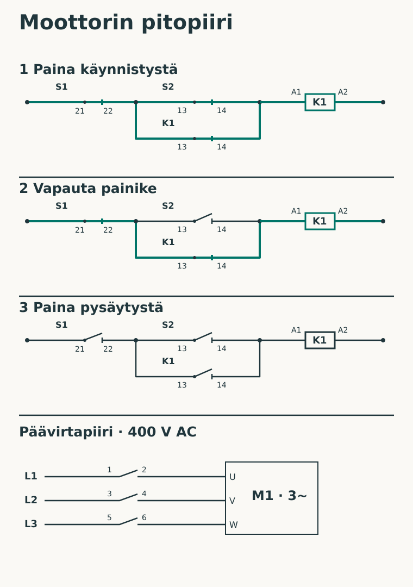

## Rele ja kontaktori

**Sähkömagneettinen rele** on sähköllä ohjattu kytkin. Sen kela on johdinkäämi. Kun kelassa kulkee virta, rautasydän magnetoituu ja vetää puoleensa liikkuvaa rautaosaa eli ankkuria. Ankkuri siirtää koskettimia. Suljettu kosketin yhdistää kaksi liitintä, avoin kosketin katkaisee niiden välisen virtareitin. Silloin rele *vetää*. Kun kelavirta katkeaa, tavallisen releen jousi palauttaa koskettimet lepoasentoon. Silloin rele *päästää*.

**Kontaktori** on sähkökäyttöinen kytkin, jonka pääkoskettimet kytkevät esimerkiksi moottorin syötön. Kylmiössä termostaatti tunnistaa lämpötilan ja pyytää tarvittaessa jäähdytystä. Ohjauspiirissä tämä pyyntö kytkee virran kontaktorin kelaan. Päävirtapiiri syöttää tehon kompressorin moottorille.

| Ohjauspiiri                                                                                                           | Päävirtapiiri                                                                             |
| --------------------------------------------------------------------------------------------------------------------- | ----------------------------------------------------------------------------------------- |
| Kun termostaatti pyytää jäähdytystä, sen kosketin sulkeutuu. Virta kulkee kontaktorin kelan läpi ja kontaktori vetää. | Kontaktorin kolme pääkosketinta sulkeutuvat. Moottori saa kolmivaihesyötön ja käynnistyy. |
| Kun termostaatin kosketin avautuu, kelavirta katkeaa ja kontaktori päästää.                                           | Pääkoskettimet avautuvat ja moottorin sähkönsyöttö katkeaa.                               |

**Miten kontaktorin liittimiä luetaan?** A1 ja A2 ovat kelan liittimet. Kun kontaktori vetää, kolme pääkosketinta (1–2, 3–4 ja 5–6) sulkeutuvat. Jokainen kytkee yhden vaiheen moottorille. Samalla sulkeutuu levossa avoin apukosketin 13–14, jolla voidaan ohjata esimerkiksi merkkivaloa. Sama mekanismi liikuttaa kaikkia neljää kosketinta. Piirrosmerkissä tätä yhteyttä voidaan kuvata katkoviivalla.

**Lisäosat.** Apukosketinlohko lisää ohjauspiiriin käytettävissä olevia koskettimia. Moottoria suojaava lämpörele seuraa moottorivirtaa. Pitkittyneen ylikuormituksen seurauksena lämpörele laukeaa ja avaa kontaktorin kelapiiriin kytketyn avauskoskettimensa. Kontaktori päästää ja moottorin syöttö katkeaa.

**Painikeohjaus ja pitopiiri.** Kun käynnistyspainiketta painetaan, kontaktorin K1 kela saa virtaa ja sen apukosketin sulkeutuu. Apukosketin muodostaa toisen virtareitin käynnistyspainikkeen rinnalle. Se pitää kelan virrallisena painikkeen vapauttamisen jälkeen. Pysäytyspainike katkaisee molemmat reitit.

Kuvassa S1 on pysäytys, S2 käynnistys ja K1 kontaktori. Vihreä korostus näyttää kelavirran reitin. Keskimmäinen tilanne esittää käynnistyspainikkeen vapauttamista. Pääpiirin koskettimet on piirretty lepoasentoon; suojaukset ja suojajohdin on jätetty tästä toimintaperiaatekuvasta pois.

**Suojakontaktori ja pitopiiri.** Toisessa ohjausesimerkissä S1 on käynnistyspainike (13–14) ja S2 pysäytyspainike (21–22). Painikkeiden tunnukset ovat päinvastoin kuin edellisessä piirroksessa. Moottorin kolmen vaiheen virrat kulkevat K1:n pääkoskettimien ja lämpöreleen F1 kautta. Jos F1 laukeaa, sen kosketin 95–96 avautuu ohjauspiirissä. K1:n kela menettää jännitteen, pitokosketin aukeaa ja pääkoskettimet katkaisevat moottorin syötön. Samalla F1:n kosketin 97–98 sulkeutuu. Sitä voi käyttää hälytykseen. Esimerkin merkkivalo H1 on kytketty K1:n kelan rinnalle, joten valo kertoo kelan saamasta jännitteestä.

**Mitä merkkivalosta voi päätellä?** Se riippuu siitä, mistä lamppu saa jännitteensä. Tässä esimerkissä H1 on kelan rinnalla. H1 voi siis palaa, vaikka kontaktorin ankkuri ei liikkuisi. Jos lamppua ohjaa kontaktorin mukana sulkeutuva apukosketin, valo kertoo myös apukoskettimen sulkeutumisesta. Kummassakin tapauksessa moottorin pyöriminen on erillinen havainto. Samaa päättelyä voi käyttää esimerkiksi puhaltimen käyntivaloon: selvitä, kertooko valo käyntipyynnöstä, kontaktorin toiminnasta vai itse puhaltimesta.

[Kylmäkoneikon ohjaus · pump-down ja kaksi kompressoria](kylmakoneikon-ohjaus.md)

## K1-releen vaihtokoskettimet

Tässä esimerkissä K1 on releen laitetunnus. A1 ja A2 ovat kelan liittimet. Sama ankkuri liikuttaa kahta sähköisesti erillistä vaihtokosketinta. Taulukon merkintä 11–12 tarkoittaa, että liittimien 11 ja 12 välillä on johtava yhteys. Kun rele vetää, liitin 11 irtoaa liittimestä 12 ja yhdistyy liittimeen 14.

| Vaihtokosketin | Yhteinen liitin | Yhteys kelan ollessa virraton | Yhteys releen vetäessä |
| -------------- | --------------- | ----------------------------- | ---------------------- |
| Ensimmäinen    | 11              | 11–12                         | 11–14                  |
| Toinen         | 21              | 21–22                         | 21–24                  |

NC tarkoittaa levossa suljettua kosketinta ja NO levossa avointa kosketinta.

### Kelan ja koskettimien merkinnät

Piirilevyreleen merkinnöissä **COIL 24 VDC** tarkoittaa 24 voltin tasajännitekelaa. AC tarkoittaa vaihtojännitettä ja DC tasajännitettä. Merkinnät **5 A / 240 V AC** ja **5 A / 24 V DC** koskevat koskettimia. Pienoisrele voidaan asentaa pistokantaan tai juottaa piirilevylle.

**Varaosa tukussa.** Tarkista itse laitteen merkinnästä kelajännite ja jännitelaji. Samannäköisessä kontaktorissa voi olla 24 V:n tai 230 V:n kela. Valitse pääkoskettimet kuorman mukaan. Kontaktorin kela voi esimerkiksi saada 24 V:n tasajännitteen, vaikka saman kontaktorin pääkoskettimet kytkevät moottorille 400 V:n kolmivaihesyötön.

## Askelrele valaistuksen ohjauksessa

Askelrelettä kutsutaan myös sysäysreleeksi, impulssireleeksi tai pulssireleeksi. Kaksitilainen askelrele vaihtaa koskettimien asentoa kerran jokaista ohjauspulssia kohti. Tavallinen jousipalautteinen rele palaa lepoasentoon kelavirran katketessa. Askelreleen koskettimet jäävät viimeksi valittuun asentoon.

Esimerkissä K1 on kaksitilainen askelrele ja A1 ja A2 ovat kelan liittimet. Kaksi erillistä kosketinta (1–2 ja 3–4) vaihtavat asentoa yhdessä. Lähtötilanteessa molemmat ovat auki. Lamppu saa virtansa koskettimen 1–2 kautta.

| Mitä painikkeelle tehdään? | Mitä kelassa tapahtuu?         | Koskettimet 1–2 ja 3–4 | Lamppu            |
| -------------------------- | ------------------------------ | ---------------------- | ----------------- |
| Lähtötilanne               | Kela on virraton               | Auki                   | Sammuksissa       |
| Ensimmäinen painallus      | Ensimmäinen ohjauspulssi alkaa | Sulkeutuvat            | Syttyy            |
| Painike vapautetaan        | Kelavirta katkeaa              | Pysyvät kiinni         | Palaa edelleen    |
| Toinen painallus           | Uusi ohjauspulssi alkaa        | Avautuvat              | Sammuu            |
| Painike vapautetaan        | Kelavirta katkeaa              | Pysyvät auki           | Pysyy sammuksissa |

**Mistä tiedät, palaako valo, kun kukaan ei paina painiketta?** Pelkkä tieto virrattomasta kelasta ei riitä. Katso, mihin asentoon viimeinen pulssi jätti koskettimen.

## Aikareleet · veto- ja päästöhidastus

Aikarele ohjaa koskettimia asetetun viiveen mukaan. Viive voi alkaa, kun ohjaus kytketään tai kun se katkaistaan.

Lue ensin koskettimen lepoasento. Sulkukosketin (NO) on levossa auki, avauskosketin (NC) kiinni. Vaihtokosketin siirtää yhteisen liittimen yhteyden koskettimelta toiselle. Katso sitten liikkuvaan koskettimeen liitettyä puolikaarta. Liike kaaren avointa puolta kohti tapahtuu viiveellä. Jos symboli on käännetty, seuraa avointa puolta suhteessa koskettimen liikkeeseen.

| Koskettimen toiminta | Vetohidasteinen                                       | Päästöhidasteinen                              |
| -------------------- | ----------------------------------------------------- | ---------------------------------------------- |
| Ohjaus alkaa         | Koskettimet vaihtavat asentoa asetetun ajan kuluttua. | Koskettimet vaihtavat asentoa heti.            |
| Ohjaus päättyy       | Koskettimet palautuvat heti.                          | Koskettimet palautuvat asetetun ajan kuluttua. |

Yllä olevan päästöhidasteisen kelan musta pääty ilmaisee päästöviivettä. Tunnista kosketin muodosta ja lepoasennosta. Tarkista liitinnumerot laitteen omasta kaaviosta.

### Harjoitus · viiden sekunnin vetohidastus

Esimerkissä S1 on ohjauskytkin, K1 aikarele ja H1 sekä H2 merkkilamppuja. Kun S1 suljetaan, sen kosketin 13–14 sulkee K1:n ohjauspiirin. Liittimien A1 ja A2 välille tulee heti 24 V vaihtojännite. K1 aloittaa ajanoton. Sen koskettimet vaihtavat asentoa, kun ohjaus on kestänyt viisi sekuntia. Kun S1 avataan, koskettimet palaavat heti perusasentoon.

Lampuilla on oma virtareittinsä vaihejohtimelta (L) nollajohtimelle (N). Siksi H2 voi palaa, vaikka K1:n ohjaus olisi pois. Perusasennossa virran reitti on L → 26–25 → H2 → N. Viiveen täytyttyä reitti on L → 18–17 → H1 → N.

| Ohjauksen vaihe            | S1     | K1 17–18 | K1 25–26 | H1          | H2          |
| -------------------------- | ------ | -------- | -------- | ----------- | ----------- |
| Ennen käynnistystä         | Auki   | Auki     | Kiinni   | Sammuksissa | Palaa       |
| Ensimmäiset viisi sekuntia | Kiinni | Auki     | Kiinni   | Sammuksissa | Palaa       |
| Viiveen kuluttua           | Kiinni | Kiinni   | Auki     | Palaa       | Sammuksissa |
| Ohjauksen päätyttyä        | Auki   | Auki     | Kiinni   | Sammuksissa | Palaa       |

**Jos S1 avataan jo kolmen sekunnin kohdalla, kumpi lamppu palaa?** H2 palaa koko ajan. Ajanotto nollautuu ennen koskettimien vaihtumista, ja seuraava sulkeminen aloittaa uuden viiden sekunnin jakson.

## Monitoimiaikarele

Esimerkin ELKO EP CRM-161/UNI yhdistää kuusi ajoitustoimintoa ja yhden vaihtokoskettimen. FUNC-valitsin määrää toiminnon, TIME-valitsin aika-alueen ja hienosäätö täsmällisen viiveen alueen sisällä. Esimerkiksi viiden sekunnin viive kuuluu alueelle 1–10 s.

| Merkintä     | Tehtävä                                                                                                              |
| ------------ | -------------------------------------------------------------------------------------------------------------------- |
| A1 ja A2     | Releen käyttöjännite. Vihreä Un-merkkivalo kertoo syötöstä.                                                          |
| S            | Erillinen ohjaustulo. Valittu toiminto määrää, alkaako ajoitus syötön kytkemisestä vai ohjaustulon tilanmuutoksesta. |
| 15, 16 ja 18 | 15 on vaihtokoskettimen yhteinen liitin. Lähdön lepoasennossa 15–16 johtaa. Kun lähtörele vetää, 15–18 johtaa.       |

**Aikakuvaajaa luetaan vasemmalta oikealle.** Vertaa kahta hetkeä: milloin syöttö tai ohjaus muuttuu ja milloin lähtö 15–18 vaihtaa tilaa? Niiden välinen aika on viive, jos lähtö vaihtaa tilaansa vasta myöhemmin. Alla on kaksi tapausta samalle releelle. Löydät niitä vastaavat kuvaajat valmistajan ohjeesta kirjaimilla a ja e. [ELKO EP:n käyttöohje ja aikakuvaajat (PDF)](https://www.elkoep.com/media/import/Elko/CRM-161/EN/Manual_CRM-161.pdf)

- **a, vetohidastus syötöstä.** Kun A1–A2 saa jännitteen, ajanotto alkaa. Jos asetusaika on 5 s ja syöttö pysyy päällä, yhteys 15–16 avautuu ja yhteys 15–18 sulkeutuu viiden sekunnin kuluttua.
- **e, päästöhidastus ohjaustulosta.** Käyttöjännite pysyy päällä. Kun S aktivoituu, lähtö vetää heti. Kun S:n ohjaus poistuu, lähtö pysyy vetäneenä asetetun ajan ja palaa sitten lepoasentoon. Näin voidaan toteuttaa esimerkiksi puhaltimen jälkikäynti ohjaamalla sen kontaktoria.

## Kellokytkimet ja ajastimet

Kellokytkin seuraa kellonaikaa. Ajastin mittaa, kuinka kauan käynnistyksestä tai ohjauksen muutoksesta on kulunut.

| Komponentti     | Miten se toimii?                                                                                                                                |
| --------------- | ----------------------------------------------------------------------------------------------------------------------------------------------- |
| Vuorokausikello | Toistaa samat päälle- ja poiskytkennät joka päivä. Mekaanisessa mallissa ajat valitaan kellokehän nastoilla tai painikkeilla.                   |
| Viikkokello     | Toistaa ohjelman viikoittain. Eri viikonpäiville voi asettaa omat kytkentäajat.                                                                 |
| Astrokello      | Laskee sijainnin ja päivämäärän perusteella auringonnousun ja -laskun ajat. Se voi esimerkiksi sytyttää ulkovalot auringon laskiessa.           |
| Kerta-ajastin   | Yksi käynnistys aloittaa yhden ajanjakson. Esimerkiksi porrasvaloajastin sytyttää valon painalluksesta ja sammuttaa sen asetetun ajan kuluttua. |
| Jaksoajastin    | Vuorottelee päällä- ja poisolojaksoja automaattisesti. Jakso toistuu niin kauan kuin ajastus on käynnissä.                                      |

## Miten ankkurin liike välittyy koskettimille?

**Pienoisrele.** Kun kelan liittimiin kytketään kelan nimellisjännite, kelavirta magnetoi kiinteän rautasydämen. Se vetää ankkuria puoleensa. Ankkuri liikuttaa ohjainlevyä, joka siirtää liikkuvaa kosketinta. Näin koskettimien liitintappien välinen yhteys vaihtuu. Kun kelavirta katkeaa, jousi palauttaa mekanismin lepoasentoon.

**Kontaktorirakenteinen rele.** Ankkuri liikuttaa kosketinsiltaa. Kun silta painuu kahta kiinteää kosketinta vasten, virta pääsee kulkemaan koskettimesta toiseen sillan kautta. Kun kelavirta katkeaa, palautusjousi irrottaa sillan koskettimista.

## Harjoitus · tunnista kuusi ajoitustoimintoa

Peitä taulukon ensimmäinen sarake. Lue oikealta, miten koskettimet reagoivat ohjauksen alkuun ja loppuun. Nimeä ajoitustoiminto ja tarkista vastauksesi.

Vaihtokoskettimen yhteinen liitin on 15. Lepoasennossa 15–16 on kiinni ja 15–18 auki.

| Toiminta                                             | Mitä koskettimissa tapahtuu?                                                                                                   |
| ---------------------------------------------------- | ------------------------------------------------------------------------------------------------------------------------------ |
| Vetohidastus                                         | 15–18 sulkeutuu viiveellä ja avautuu heti ohjauksen päättyessä.                                                                |
| Päästöhidastus                                       | 15–18 sulkeutuu heti ja avautuu viiveellä ohjauksen päätyttyä.                                                                 |
| Tauolla alkava vilkkutoiminto                        | Ohjauksen alussa 15–16 pysyy hetken kiinni. Sen jälkeen 15–18 ja 15–16 johtavat vuorotellen niin kauan kuin ohjaus jatkuu.     |
| Veto- ja päästöhidastus kahdella vaihtokoskettimella | 15–18 ja 25–28 sulkeutuvat yhtä aikaa viiveen jälkeen. Molemmat pysyvät kiinni vielä ohjauksen päätyttyä ja avautuvat yhdessä. |
| Vetohidastettu ja välitön vaihtokosketin             | 21–24 sulkeutuu heti, 15–18 vasta viiveen jälkeen. Molemmat avautuvat heti ohjauksen päättyessä.                               |
| Päästöhidastus kahdella vaihtokoskettimella          | 15–18 ja 25–28 sulkeutuvat heti ja avautuvat yhdessä päästöviiveen jälkeen.                                                    |

**Sovella vetohidastettua ja välitöntä vaihtokosketinta.** Kosketin 21–24 voi sytyttää käyntipyyntöä osoittavan lampun heti. Jos 15–18 ohjaa kontaktorin kelaa, kontaktori vetää vasta viiveen kuluttua. Jos pyyntö päättyy ennen sitä, vain lamppu ehti syttyä.

## Lähteet ja ylläpitotiedot

Oppitunti 16.11.2026. Muistio kokoaa oppitunnin esimerkit ja niitä täydentävät selitykset. Laitetunnukset ja esimerkkijännitteet kuuluvat kuhunkin kuvattuun harjoitukseen.

### Täydentävät valmistajalähteet

- [ELKO EP, CRM-161-käyttöohje ja toimintojen aikakuvaajat](https://www.elkoep.com/media/import/Elko/CRM-161/EN/Manual_CRM-161.pdf)
